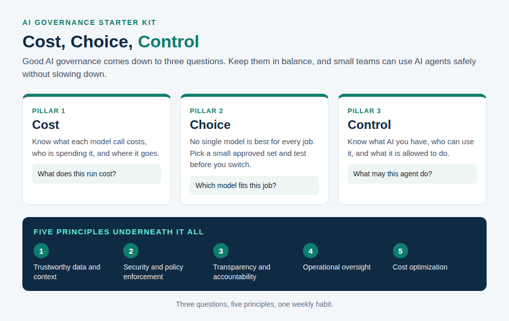
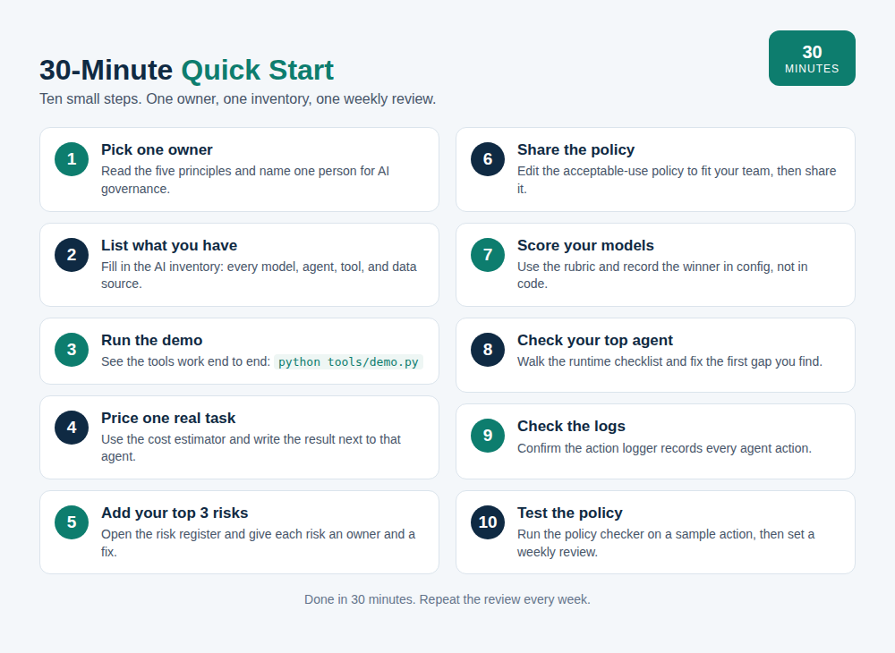
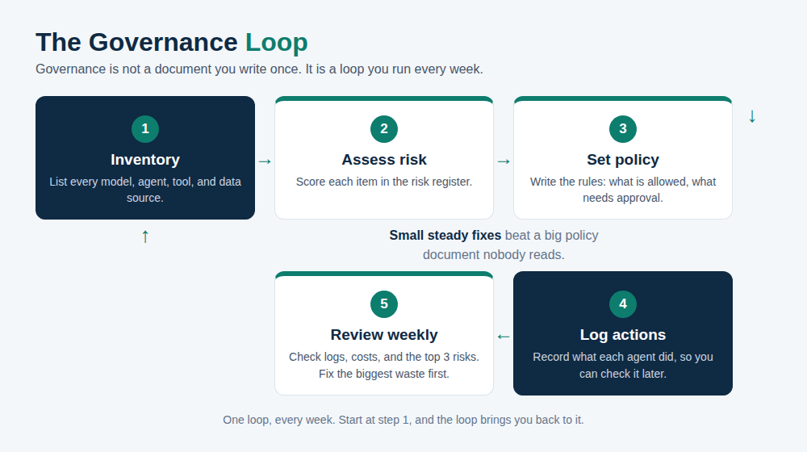
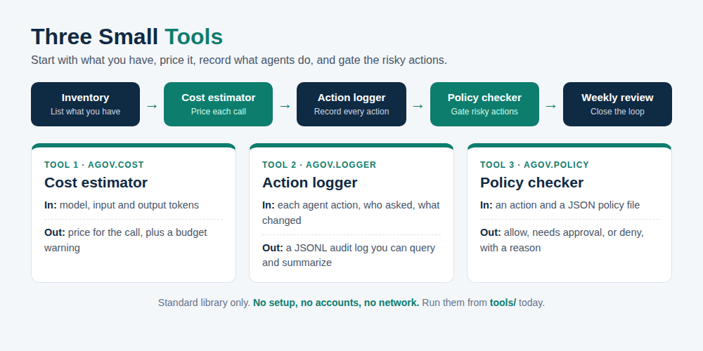

# AI Governance Starter Kit

A small, practical starter kit for teams that want to use AI agents safely without slowing down. It gives you checklists, simple templates, and tiny tools you can run today. No enterprise platform is required.

## Watch the overview

It walks through the framework, the 30-minute quick start, the templates, and the three tools. You can also [watch it on Drive](https://drive.google.com/file/d/1NEH425pw0EiqjHTfLwN7LzgW5LCt1UIH/view?usp=drivesdk).

## Who it is for

This kit is for teams of 2 to 20 people: startups, small product teams, and anyone building or using AI agents. It assumes you have a few models, a few agents, and a few data sources, and you want to keep track of them before they grow out of control.

## The framework: cost, choice, control

*Designed in HTML and CSS.*

Good AI governance comes down to three questions. Keep them in balance. If you only watch cost, you may pick a weak model. If you only chase new models, your bill and your risk grow. If you only add controls, your team stops shipping.

### Cost

Know what each model call costs, who is spending it, and where it goes. AI is usually billed by the amount of text processed, and agents can make many calls in one task. Set a budget, set an alert before you hit it, and set a hard stop so a runaway agent cannot empty the budget. Use a cheaper model when the job is simple. See [docs/02-cost.md](docs/02-cost.md).

### Choice

No single model is best for every job. Some are better at writing code, some at summarizing, some at quick answers. Give your team a small, approved set of models, test new ones on real tasks before you switch, and keep model names in config files so swapping one does not mean rewriting code. See [docs/03-choice.md](docs/03-choice.md).

### Control

Know what AI you have, who can use it, and what it is allowed to do. List every model, agent, tool, and data source. Give each agent only the access it needs. Require a human to approve actions that change something, such as sending a message, deleting data, or pushing code. Log what agents do so you can check it later. See [docs/04-control.md](docs/04-control.md).

## 30-minute quick start

*Designed in HTML and CSS.*

1. Read [docs/01-principles.md](docs/01-principles.md) and pick one owner for AI governance in your team.
2. List what you have in [templates/ai-inventory.csv](templates/ai-inventory.csv): every model, agent, tool, and data source, plus who owns each one.
3. Run the demo to see the tools work: `python tools/demo.py`
4. Estimate one real task with the cost estimator in [tools/agov/](tools/agov/) and write the result next to that agent in your inventory.
5. Open [templates/risk-register.csv](templates/risk-register.csv) and add your top three risks, with an owner and a fix for each.
6. Read [templates/acceptable-use-policy.md](templates/acceptable-use-policy.md), edit it to match your team, and share it with everyone.
7. Score your main model choices with [templates/model-selection-rubric.md](templates/model-selection-rubric.md) and record the winner in config, not in code.
8. Walk through [templates/agent-runtime-checklist.md](templates/agent-runtime-checklist.md) for your most used agent and fix the first gap you find.
9. Check that your agent logs each action with the action logger in [tools/agov/](tools/agov/).
10. Run the policy checker in [tools/agov/](tools/agov/) on a sample agent action, then set a weekly 30-minute review in your calendar.

*Designed in HTML and CSS.*

## Tools at a glance

*Designed in HTML and CSS.*

The three tools live in [tools/agov/](tools/agov/) and are covered in [tools/README.md](tools/README.md). Start with the inventory, price the work, log what agents do, and let the policy checker gate the risky actions.

## Repo map

- `README.md`: this file.
- `docs/01-principles.md`: five principles, restated for a small team.
- `docs/02-cost.md`: how to track, limit, and cut AI spend.
- `docs/03-choice.md`: how to pick, test, and swap models.
- `docs/04-control.md`: how to inventory, restrict, guard, and log AI.
- `templates/ai-inventory.csv`: list of your models, agents, tools, and data.
- `templates/risk-register.csv`: list of your risks, owners, and fixes.
- `templates/acceptable-use-policy.md`: a short policy your team can adopt.
- `templates/model-selection-rubric.md`: how to score and compare models.
- `templates/agent-runtime-checklist.md`: checks to run before an agent goes live.
- `tools/agov/`: cost estimator, action logger, and policy checker.
- `tools/demo.py`: a short demo that runs the tools end to end.

## Attribution

Inspired by "Big Book of AI Governance" by Databricks.

## License

MIT License. See [LICENSE](LICENSE). Use this kit freely. Adapt the templates to your team, keep what works, and drop what does not.
